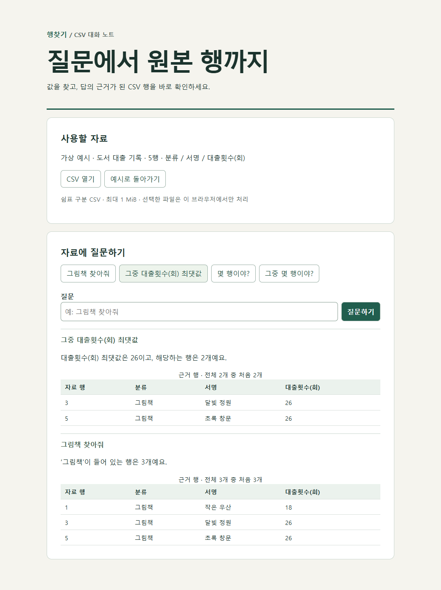

# 행찾기 · CSV 대화 노트

“그림책 찾아줘”라고 물으면 가상 도서 대출 기록 5행에서 해당하는 3행을 보여 줍니다. 이어서 “그중 대출횟수(회) 최댓값”을 누르면 **26회**를 기록한 **달빛 정원**과 **초록 창문**을 원본 값과 함께 확인할 수 있습니다.

데이터 탐색 챗봇에서 다룬 문제 중 **질문으로 값을 찾고 근거를 확인하는 과정**을 골라 새로 구현한 포트폴리오입니다. 브라우저에서 동작하는 한국어 규칙 기반 데모이며, 외부 패키지나 API 키가 필요하지 않습니다.

## 직접 사용하기

1. GitHub에서 **Code → Download ZIP**으로 내려받고 압축을 풉니다.
2. 폴더 안의 **index.html**을 브라우저에서 엽니다. 가상의 도서 기록과 첫 검색 결과가 보입니다.
3. **그중 대출횟수(회) 최댓값**을 눌러 후속 질문을 해 보세요. **CSV 열기**로 자신의 자료를 선택해도 됩니다.

| 질문 형식 | 동작 |
| --- | --- |
| 그림책 찾아줘 | 각 셀에서 검색어를 포함한 행 찾기 |
| 몇 행이야? | 현재 파일의 전체 자료 행 수 확인 |
| 그중 몇 행이야? | 직전 결과에 포함된 행 수 확인 |
| 열 이름 최댓값 | 지정한 열의 정수 비교 및 동률 전체 식별 |

## 구현에서 중요하게 본 점

- **근거 추적** — 자료 행 번호는 헤더 다음 레코드부터 1로 셉니다. 답변 표에는 해당 행의 모든 열을 담고, 일치 건수와 처음 5개 행을 표시합니다.
- **질문의 범위** — “그중”을 붙인 질문은 직전 결과 안에서 처리합니다. 새 파일을 선택하면 이전 파일의 질문과 결과를 지웁니다.
- **잘못된 수치 방지** — 비교 범위에 빈칸이나 소수, 단위 문자가 섞여 있으면 정수 최댓값을 확정하지 않습니다. 한 열의 값은 같은 단위로 작성되어 있어야 합니다.
- **로컬 처리** — 파일 크기를 읽기 전에 검사한 뒤 메모리에서 한 번 파싱합니다. 파일·질문을 저장하거나 전송하는 기능이 없습니다.

쉼표 구분 UTF-8·CP949 CSV, 최대 1 MiB, 자료 5,000행, 64열을 지원합니다. 따옴표로 감싼 쉼표와 줄바꿈도 읽습니다. 화면에 기본으로 표시되는 제목과 수치는 모두 데모용으로 만든 값입니다.

## 코드와 검증

- `csv.js` · 문자 인코딩, CSV 검증, 질문 해석과 행 선택
- `app.js` · 파일 전환, 대화 범위, 원본 행 표시
- `csv.test.cjs` · 범위 유지, 공동 최댓값, CSV 인코딩과 잘못된 입력 처리

Node.js가 설치되어 있으면 `node --test csv.test.cjs`로 핵심 로직을 확인할 수 있습니다.
